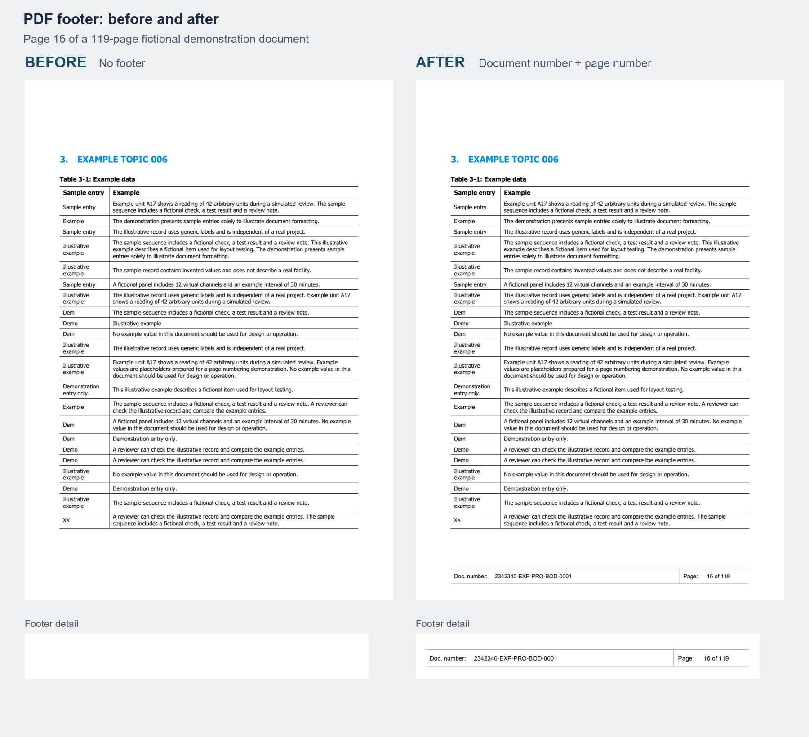

# PDF Footer Batch

Add page numbers and an optional document number to existing PDF files. The tool can process a single PDF or a directory of PDFs without opening or editing Word.



The comparison shows page 16 of a 119-page fictional demonstration document. The complete input and output PDFs in [`examples/`](examples/) are separate, independently generated three-page samples.

## What it does

- Adds `Page 1 of N` to each page, or a two-column footer with a document number and page count.
- Processes all PDFs in a directory, retaining their relative folder structure.
- Writes to a separate location and skips files that already exist at the destination.
- Offers a dry run to inspect input files before writing.
- Reports and skips PDFs that are encrypted, signed, rotated, or have nonstandard page boxes. These need separate handling.

The script places a footer in a fixed area at the bottom of each page. It **does not detect whether the original content occupies that area**. Check representative pages and any files with unusual layouts before processing a batch. The script does not remove sensitivity labels or change organizational policies.

## Quick start

Python 3.10 or later is required. From the repository directory:

```powershell
python -m venv .venv
.\.venv\Scripts\Activate.ps1
python -m pip install -r requirements.txt
```

On macOS or Linux, activate with `source .venv/bin/activate`.

Preview and process the example:

```powershell
python pdf_footer.py examples/fictional_input.pdf output/example.pdf --doc-number 2342340-EXP-PRO-BOD-0001 --dry-run
python pdf_footer.py examples/fictional_input.pdf output/example.pdf --doc-number 2342340-EXP-PRO-BOD-0001
```

For page numbers only, omit `--doc-number`. A document number must use printable ASCII and fit in the footer. The output directory is created if needed.

## Batch processing

```powershell
python pdf_footer.py input_pdfs output_pdfs --doc-number 2342340-EXP-PRO-BOD-0001 --dry-run
python pdf_footer.py input_pdfs output_pdfs --doc-number 2342340-EXP-PRO-BOD-0001
```

Use `--doc-number "{stem}"` to use each filename without its extension as its document number. The output directory must be outside the input directory. The program keeps processing other files after a failure and returns a nonzero exit code if any file fails.

## Verification

The footer shown above was applied to a 119-page PDF. Every page was checked for its document number and page number; rendered pages were compared with the source outside the footer area. Six pages were also inspected visually. These checks describe that sample, not every possible PDF.

## Dependencies

[pypdf](https://pypdf.readthedocs.io/) reads and updates PDF files; [ReportLab](https://www.reportlab.com/dev/docs/) draws the footer. No Adobe Acrobat installation is required.
